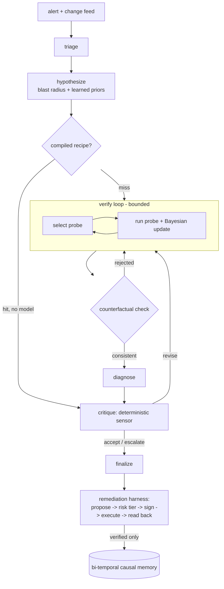

# graphloop

[](https://github.com/bernardosaab/graphloop/actions/workflows/ci.yml)
  

**Graph engineering meets loop engineering.** An incident root-cause agent built as an explicit
LangGraph workflow over a **Causal Context Graph (CCG)**, with **bounded loops embedded only where
iteration pays off**, benchmarked against a classic ReAct tool loop on the same incidents, tools,
budget and model.

> The model proposes; the harness decides what actually happens.

## Results (100 simulated incidents, paired design)

| Agent | Resolved (95% CI) | Precision | Wrong writes | Escalated | LLM calls | Tokens / incident | Cost / resolved |
|---|---|---|---|---|---|---|---|
| `loop` (ReAct baseline) | 56% [46%, 65%] | 56% | **44** | 0 | 3.7 | 7,220 | $0.00201 |
| `graph` | 77% [68%, 84%] | 100% | **0** | 23 | 3.6 | 1,112 | $0.00027 |
| `graph+memory` | 80% [71%, 87%] | 100% | **0** | 20 | 2.9 | 900 | $0.00021 |

Exact McNemar test, loop vs graph+memory: p = 7e-05. A run counts as *resolved* only when its
remediation passed a fail-closed gate, executed, and a **read-back of the system of record**
confirmed the fix. Full report: [`results/RESULTS.md`](results/RESULTS.md); interactive report with
the CCG visualisation: `results/report.html`.

 

> These numbers come from a deterministic, agent-agnostic **simulated** model. They measure the
> *architecture* under controlled conditions; see [ADR 0005](docs/adr/0005-simulated-llm-evaluation.md).
> Re-run against a real open-weight model with `--llm ollama:qwen2.5:7b-instruct`.

## How it works



* **Causal Context Graph.** One typed graph holds the *context* (services, dependencies, changes,
  incidents, evidence) and the *causal* layer (`CAUSES` edges from fault modes to symptoms).
  Causal knowledge is bi-temporal and append-only: assertions are invalidated, never deleted, and
  can be queried `as_of` any point in time.
* **Loops inside the graph.** Verification, counterfactual rejection and critique are loops with
  hard bounds in code. The model only chooses between a few graph-ranked options.
* **Loops are not agents.** Corroborated causal patterns compile into a model-free recipe;
  `graph+memory` resolves about 30% of incidents with zero model calls on the normal path.
* **Abstain over guessing.** Without direct evidence the agent escalates with a suggestion.
  Escalations are counted, not hidden.
* **Fail-closed writes.** Remediation is quoted exactly, tiered by blast radius (soft = versioned
  policy signs; hard/critical = a named person via a LangGraph `interrupt`), fingerprinted,
  executed once (idempotency key), read back, and logged in a hash-chained audit log.
* **Harness caps.** Probe, model-call, spend and wall-time caps live in a single model gateway.
  Hitting one triggers a loud, rule-based degraded mode. Runs are checkpointed and resume after
  transient failures (at most twice).
* **Evaluation.** Paired design, Wilson intervals, exact McNemar, pass^k, retrieval (recall@3)
  scored separately from diagnosis, error-analysis clusters, cost per resolved incident. The test
  suite includes **release gates** (zero wrong writes, significant win over the baseline).

## Quickstart

```bash
uv sync
uv run graphloop run --incident 3 --agent graph+memory --approve prompt   # sign writes yourself
uv run graphloop bench --scenarios 100 --out results                      # full paired benchmark
uv run graphloop bench --llm ollama:qwen2.5:7b-instruct --scenarios 30    # real local model
make check                                                                # ruff, mypy --strict, tests
```

Everything is open source and runs offline at zero cost: the simulated model needs no network,
and Ollama serves open-weight models locally.

## Layout

```
src/graphloop/
  domain/       vocabulary, topology, Bayesian belief, Causal Context Graph (store port + networkx)
  simulator/    seeded topologies, incidents, red herrings, log sampling, tools, system of record
  llm/          constrained-decision port, simulated reasoner, Ollama adapter
  harness/      run caps, model gateway (cost quote/attribution), durable execution
  agents/       graph agent (LangGraph + verify sub-graph) and ReAct loop baseline
  governance/   proposals, approval policy, write gate, remediation workflow, audit log
  eval/         paired runner, statistics, failure taxonomy
  report/       summaries, SVG charts, Mermaid/vis-network views, Markdown/HTML writers
```

## Documentation

* [Architecture](docs/architecture.md): layers, control plane vs data plane, extension points
* [Decision records](docs/adr/README.md): the nine design decisions and their trade-offs
* [Glossary](CONTEXT.md)

## Limitations

* The simulator is deliberately simple (one root cause per incident, a fixed fault taxonomy).
* The simulated reasoner is a calibrated stand-in, not a language model. Its failure modes
  (salience-driven attention, limited context, slips) are documented and shared by both agents.
* The benchmark reviewer signs everything it is shown, so results measure agents and gates,
  not reviewer skill.

## License

MIT
