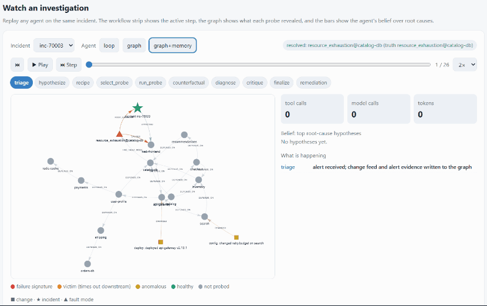
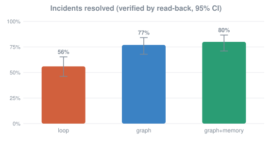
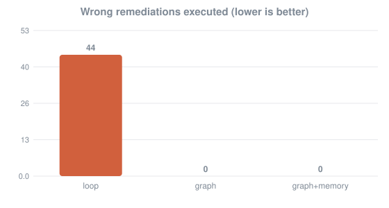
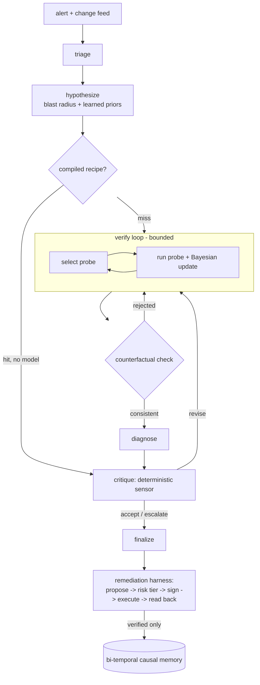

# graphloop

[](https://github.com/bernardosaab/graphloop/actions/workflows/ci.yml)
  

**Graph engineering meets loop engineering.** An incident root-cause agent built as an explicit
LangGraph workflow over a **Causal Context Graph (CCG)**, with **bounded loops embedded only where
iteration pays off**, benchmarked against a classic ReAct tool loop on the same incidents, tools,
budget and model.

> The model proposes; the harness decides what actually happens.



<sub>The same incident, two architectures (from the <a href="https://bernardosaab.github.io/graphloop/">live report</a>). <code>graph+memory</code> follows the evidence to <code>catalog-db</code>; a named engineer signs the critical write and the read-back confirms the fix. The <code>loop</code> agent is drawn to a recent deploy, spends about 6x the tokens, and its policy-signed rollback fails read-back.</sub>

## Results (100 simulated incidents, paired design)

| Agent | Resolved (95% CI) | Precision | Wrong writes | Escalated | LLM calls | Tokens / incident | Cost / resolved |
|---|---|---|---|---|---|---|---|
| `loop` (ReAct baseline) | 56% [46%, 65%] | 56% | **44** | 0 | 3.7 | 7,220 | $0.00201 |
| `graph` | 77% [68%, 84%] | 100% | **0** | 23 | 3.6 | 1,112 | $0.00027 |
| `graph+memory` | 80% [71%, 87%] | 100% | **0** | 20 | 2.9 | 900 | $0.00021 |

Exact McNemar test, loop vs graph+memory: p = 7e-05. A run counts as *resolved* only when its
remediation passed a fail-closed gate, executed, and a **read-back of the system of record**
confirmed the fix. **[Live interactive report](https://bernardosaab.github.io/graphloop/)**, with the incident graph,
probe-order overlay and side-by-side trajectories. It is rebuilt and redeployed from `main` on every
push, after the tests pass. Static version: [`results/RESULTS.md`](results/RESULTS.md).

 

> These numbers come from a deterministic, agent-agnostic **simulated** model. They measure the
> *architecture* under controlled conditions; see [ADR 0005](docs/adr/0005-simulated-llm-evaluation.md).
> Re-run against a real open-weight model with `--llm ollama:qwen2.5:7b-instruct`.

## How it works



* **Causal Context Graph.** One typed graph holds the *context* (services, dependencies, changes,
  incidents, evidence) and the *causal* layer (`CAUSES` edges from fault modes to symptoms).
  Causal knowledge is bi-temporal and append-only: assertions are invalidated, never deleted, and
  can be queried `as_of` any point in time.
* **Loops inside the graph.** Verification, counterfactual rejection and critique are loops with
  hard bounds in code. The model only chooses between a few graph-ranked options.
* **Loops are not agents.** Corroborated causal patterns compile into a model-free recipe;
  `graph+memory` resolves about 30% of incidents with zero model calls on the normal path.
* **Abstain over guessing.** Without direct evidence the agent escalates with a suggestion.
  Escalations are counted, not hidden.
* **Fail-closed writes.** Remediation is quoted exactly, tiered by blast radius (soft = versioned
  policy signs; hard/critical = a named person via a LangGraph `interrupt`), fingerprinted,
  executed once (idempotency key), read back, and logged in a hash-chained audit log.
* **Harness caps.** Probe, model-call, spend and wall-time caps live in a single model gateway.
  Hitting one triggers a loud, rule-based degraded mode. Runs are checkpointed and resume after
  transient failures (at most twice).
* **Evaluation.** Paired design, Wilson intervals, exact McNemar, pass^k, retrieval (recall@3)
  scored separately from diagnosis, error-analysis clusters, cost per resolved incident. The test
  suite includes **release gates** (zero wrong writes, significant win over the baseline).

## Run and test locally

**Prerequisites:** git and [uv](https://docs.astral.sh/uv/getting-started/installation/). uv
installs Python 3.12 for you. Nothing else is needed: the default model is simulated and offline.

```bash
git clone https://github.com/bernardosaab/graphloop.git
cd graphloop
uv sync                                   # create .venv with all dependencies (locked)
```

**Test.** These are the same checks CI runs. The test suite includes the benchmark release gates.

```bash
uv run ruff check src tests && uv run ruff format --check src tests
uv run mypy src                           # strict type checking
uv run pytest --cov                       # 81 tests, coverage gate 85%
# or simply: make check                   (macOS/Linux, or Windows with make installed)
```

**Run one incident** and watch the trajectory, the risk tier and the signature:

```bash
uv run graphloop run --incident 3 --agent graph+memory
uv run graphloop run --incident 3 --agent loop                     # same incident, baseline agent
uv run graphloop run --incident 3 --agent graph --approve prompt   # you sign hard/critical writes
```

**Run the benchmark and view the report:**

```bash
uv run graphloop bench --scenarios 100 --seed 7 --out results
uv run python -m http.server 8000 --directory results   # then open http://localhost:8000/report.html
```

`results/RESULTS.md` (Markdown, SVG and Mermaid) renders directly on GitHub. The HTML report loads
its graph library from a CDN, so it needs an internet connection.

**Optional: a real open-weight model through [Ollama](https://ollama.com):**

```bash
ollama pull qwen2.5:7b-instruct           # one-off download, runs locally for free
uv run graphloop bench --llm ollama:qwen2.5:7b-instruct --scenarios 30 --out results-ollama
GRAPHLOOP_OLLAMA=1 uv run pytest -m ollama  # live contract test
```

**Or with Docker** (nothing to install but Docker):

```bash
docker build --target test .                      # runs the full test suite inside the image
docker build -t graphloop .
docker run --rm graphloop run --incident 3 --agent graph+memory
docker compose run --rm graphloop bench --out results     # writes ./results
```

The image is multi-stage: the runtime is a slim, non-root layer containing only the locked
environment. `compose.yaml` includes an opt-in Ollama service (`--profile ollama`) for real-model
runs. CI builds and smoke-tests the image on every push.

**Deploy.** Every push to `main` runs CI (`.github/workflows/ci.yml`). The Pages workflow
(`.github/workflows/pages.yml`) re-runs the tests, regenerates the benchmark from the committed
code and publishes the interactive report. Nothing else needs deploying: there are no servers and
no API keys.

## Layout

```
src/graphloop/
  domain/       vocabulary, topology, Bayesian belief, Causal Context Graph (store port + networkx)
  simulator/    seeded topologies, incidents, red herrings, log sampling, tools, system of record
  llm/          constrained-decision port, simulated reasoner, Ollama adapter
  harness/      run caps, model gateway (cost quote/attribution), durable execution
  agents/       graph agent (LangGraph + verify sub-graph) and ReAct loop baseline
  governance/   proposals, approval policy, write gate, remediation workflow, audit log
  eval/         paired runner, statistics, failure taxonomy
  report/       summaries, SVG charts, Mermaid/vis-network views, Markdown/HTML writers
```

## Documentation

* [Architecture](docs/architecture.md): layers, control plane vs data plane, extension points
* [Decision records](docs/adr/README.md): the nine design decisions and their trade-offs
* [Glossary](CONTEXT.md)

## Limitations

* The simulator is deliberately simple (one root cause per incident, a fixed fault taxonomy).
* The simulated reasoner is a calibrated stand-in, not a language model. Its failure modes
  (salience-driven attention, limited context, slips) are documented and shared by both agents.
* The benchmark reviewer signs everything it is shown, so results measure agents and gates,
  not reviewer skill.

## Roadmap

* **Measured run on a real open-weight model.** Run the benchmark through Ollama (for example
  `qwen2.5:7b-instruct`) and publish the results next to the simulated ones, labelled as measured,
  with the model and hardware named (see [ADR 0005](docs/adr/0005-simulated-llm-evaluation.md)).
  The adapter, the opt-in contract test and the Compose service are already in place.
* A persistent checkpointer (SQLite or Postgres) and a graph-database adapter for the CCG port.

## License

MIT
