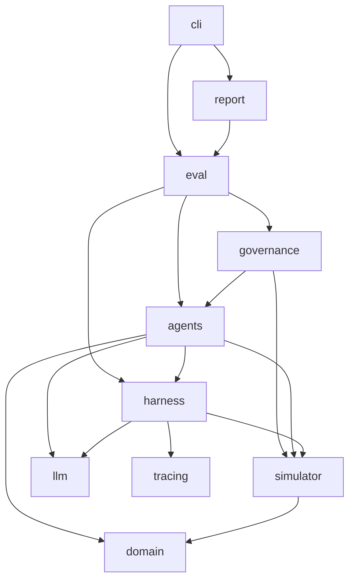

# Architecture

## Layers and dependencies

Dependencies point inward: `domain` imports nothing from the other packages.

| Package | Owns | Key types |
|---|---|---|
| `domain` | the vocabulary, topology, Bayesian belief and Causal Context Graph | `Diagnosis`, `Finding`, `BeliefState`, `CausalContextStore` |
| `simulator` | seeded incidents, telemetry, tools and the system of record | `ScenarioGenerator`, `IncidentEnvironment` |
| `llm` | the constrained-decision port and its adapters | `DecisionRequest`, `SimulatedLLM`, `OllamaClient` |
| `harness` | caps, the model gateway, cost quotes and durable execution | `RunPolicy`, `ModelGateway`, `invoke_durably` |
| `agents` | the two agents behind one contract | `RCAAgent`, `GraphAgent`, `LoopAgent`, `Investigation` |
| `governance` | the control plane for writes | `ChangeProposal`, `ApprovalPolicy`, `WriteGate`, `DecisionLog` |
| `eval` | the paired benchmark, statistics and failure taxonomy | `run_benchmark`, `wilson`, `mcnemar_exact` |
| `report` | summaries and views | `write_report` |

## Control plane and data plane

Agents are the data plane: they read telemetry and produce an `Investigation`. The control
plane decides what may happen next: the `ModelGateway` (caps and cost), the
`RemediationWorkflow` (risk tier, signature, fingerprint, idempotency, read-back) and
`GraphAgent.learn` (the only memory writer, called only after a verified read-back). No prompt
reaches the control plane.

## One incident, end to end

1. The runner creates an `IncidentEnvironment` and wraps the model in a `ModelGateway` with the
   run's `RunPolicy`.
2. The agent investigates and returns an `Investigation`: committed or escalated, with its
   diagnosis, evidence ids and path (compiled, agentic or loop).
3. `RemediationWorkflow.run` proposes, assesses, gets the change signed (by policy, or by a
   person through an interrupt), executes through the `WriteGate`, and reads back.
4. `agent.learn(investigation, verified, at)` updates causal memory, only if verified.
5. The tracer's events become the cost metrics, the failure cluster and the report's trajectory
   views.

## Extending

* **A new model provider** implements `LLMClient.decide`. Constrain the answer to the option ids.
* **A new graph store** implements `CausalContextStore` (see ADR 0002).
* **A new fault type** adds a `FaultType`, a `REMEDY` entry, a telemetry signature in the
  simulator and its likelihood ratios.
