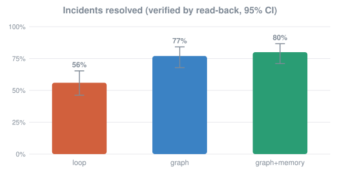
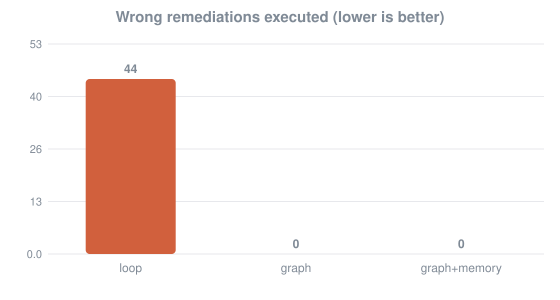
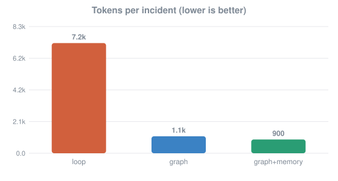
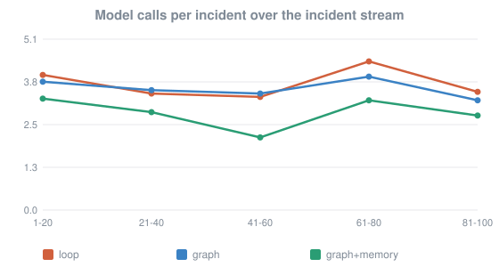
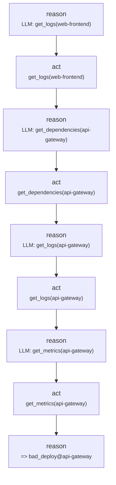
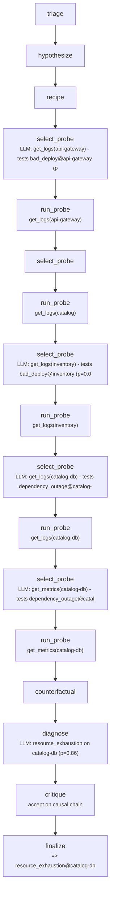

# Benchmark results

_Generated 2026-11-14 02:13 UTC by `graphloop bench` · 100 incidents x 1 repeat(s) · model `simulated` · seed 7 · budget 12 probes._

Every agent receives the same incident stream, alert, service catalog, tools, probe budget and model seed (a paired design). A run counts as **resolved** only when its remediation passed the fail-closed gate, executed, and the read-back confirmed the incident was fixed.

| Agent | Resolved (95% CI) | Precision | Coverage | Wrong writes | Escalated | Tool calls | LLM calls | Tokens | Cost / resolved | Compiled path | p95 |
|---|---|---|---|---|---|---|---|---|---|---|---|
| `loop` | 56% [46%, 65%] | 56% | 100% | 44 | 0 | 2.7 | 3.7 | 7,220 | $0.00201 | 0% | 17 ms |
| `graph` | 77% [68%, 84%] | 100% | 77% | 0 | 23 | 3.1 | 3.6 | 1,112 | $0.00027 | 0% | 30 ms |
| `graph+memory` | 80% [71%, 87%] | 100% | 80% | 0 | 20 | 3.0 | 2.9 | 900 | $0.00021 | 30% | 32 ms |

 

 

## Paired significance

Exact McNemar test, `loop` vs `graph+memory` on identical incidents: 6 incidents only the loop resolved, 30 only the graph agent resolved, **p = 7e-05**.

## Error analysis

| Agent | Failure clusters |
|---|---|
| `loop` | `confounded_by_change` x 41, `wrong_fault_type` x 3 |
| `graph` | `escalated` x 23 |
| `graph+memory` | `escalated` x 20 |

**Retrieval vs generation.** Root cause in the graph agent's top-3 hypotheses (recall@3): `graph` 100%, `graph+memory` 100%. Misses after a retrieval hit are therefore decision or evidence problems, not retrieval problems.

## One incident, two architectures (`inc-70003`)

Ground truth: `resource_exhaustion@catalog-db`. The loop agent concluded `bad_deploy@api-gateway`; the graph agent concluded `resource_exhaustion@catalog-db`.

**loop**

**graph+memory**

## How to read these numbers

* Results with `simulated` are produced by a deterministic, agent-agnostic stand-in for a model (see `docs/adr/0005-simulated-llm-evaluation.md`). They measure the *architecture* under controlled conditions; they are not claims about any specific model. Re-run with `--llm ollama:<model>` for a real open-weight model.
* Cost uses a reference price of $0.15 / $0.60 per million input / output tokens so agents are comparable; local models cost nothing at the margin.
* Escalations are not failures of safety: the agent declined to act without direct evidence and handed the incident to a person with its best suggestion.
